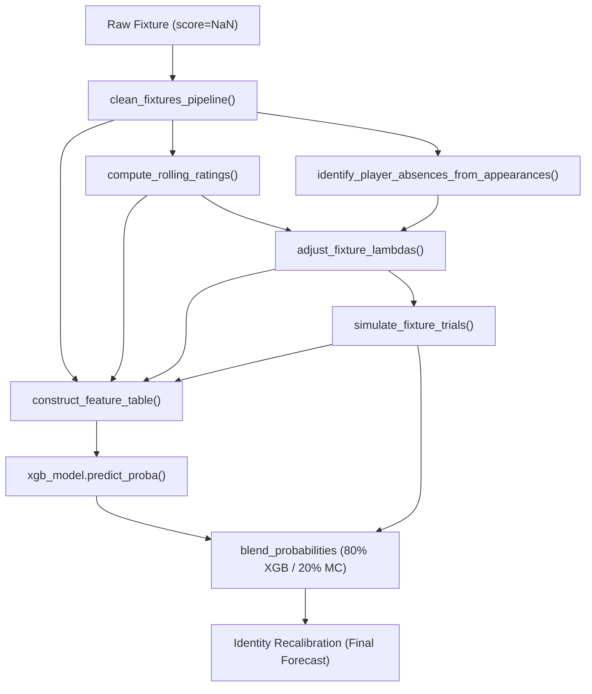

# Task 5.3a — Repository & Data Capability Audit Report

**Date:** 2026-11-07  
**Auditor:** Antigravity AI Assistant  
**Pipeline Stage:** 07_evaluation / 08_prediction (Task 5.3a)  
**Repository State:** Clean working tree at commit [`3fc9adc`](https://github.com/AlexOla-NG/sports-betting-poisson-ml/commit/3fc9adc)  
**Specification Under Audit:**  
* Model: Context-only XGBoost (31 features)  
* Ensemble Blend: 80% Context-XGBoost + 20% Monte Carlo simulation (`blend_context`)  
* Calibration: `identity` (retains raw ensemble probabilities without recalibration, per Task 5.2)  
* Class Order: `0 = home_win`, `1 = draw`, `2 = away_win`  

---

## 1. Executive Readiness Decision

| Capability | Status | Core Rationale & Blocking Factors |
| :--- | :---: | :--- |
| **1. Frozen-Model Recent-Match Evaluation** *(Cutoff: 2026-05-24)* | **PARTIALLY READY / BLOCKED ON LIVE xG** | **FBref live schedule verified (91 completed matches); live Understat xG blocked.** Bounded live probe of Season 2026/2027 confirmed 91 completed matches (`2026-08-21` to `2026-11-06`) and 289 upcoming fixtures. However, live Understat schedule ingestion failed with `JSONDecodeError: Expecting value: line 1 column 1 (char 0)` on `https://understat.com/league/EPL/2026`, blocking automated live xG. Furthermore, **no fitted 31-feature context-only XGBoost model artifact exists on disk**; [`models/xgboost_model.json`](file:///Users/mac/Documents/Projects/SportsBettingPoisson+ML/models/xgboost_model.json) contains the deprecated 51-feature full model. |
| **2. Current-Model Inference for Upcoming Fixtures** | **BLOCKED** | **Absence logic defect on unplayed fixtures & blocked live Understat xG.** Upcoming schedule is available from FBref (289 fixtures). However, live inference is blocked by the absence logic defect: unplayed fixtures have 0 player appearance logs, causing 100% of established starters to be incorrectly classified as absent. Crucially, because Context-XGBoost includes `num_home_absences_applied` and `num_away_absences_applied` in its 31 features and Monte Carlo relies on absence-adjusted lambdas, this defect corrupts **100% of the ensemble blend**. |
| **3. Saving Forecasts & Post-Match Joining** | **FEASIBLE (Implementation Pending)** | Parquet snapshot serialization with immutable run-versioned metadata, stable `fixture_id` joining, and deterministic evaluation scoring is architecturally verified and straightforward to implement following existing repository conventions. However, production implementation in `src/prediction/predict_fixtures.py` and dedicated unit tests are PENDING implementation in Task 5.3c/5.3d. |

---

## 2. Repository State & Files Inspected

### Inspected Source Modules
* [`src/config/config.yaml`](file:///Users/mac/Documents/Projects/SportsBettingPoisson+ML/src/config/config.yaml) and [`src/config/loader.py`](file:///Users/mac/Documents/Projects/SportsBettingPoisson+ML/src/config/loader.py)
* [`src/ingestion/soccerdata_client.py`](file:///Users/mac/Documents/Projects/SportsBettingPoisson+ML/src/ingestion/soccerdata_client.py)
* [`src/processing/clean_features.py`](file:///Users/mac/Documents/Projects/SportsBettingPoisson+ML/src/processing/clean_features.py)
* [`src/ratings/poisson.py`](file:///Users/mac/Documents/Projects/SportsBettingPoisson+ML/src/ratings/poisson.py)
* [`src/adjustments/absence_classifier.py`](file:///Users/mac/Documents/Projects/SportsBettingPoisson+ML/src/adjustments/absence_classifier.py)
* [`src/adjustments/lambda_adjustment.py`](file:///Users/mac/Documents/Projects/SportsBettingPoisson+ML/src/adjustments/lambda_adjustment.py)
* [`src/simulation/scoreline_matrix.py`](file:///Users/mac/Documents/Projects/SportsBettingPoisson+ML/src/simulation/scoreline_matrix.py)
* [`src/simulation/monte_carlo.py`](file:///Users/mac/Documents/Projects/SportsBettingPoisson+ML/src/simulation/monte_carlo.py)
* [`src/ml/feature_table.py`](file:///Users/mac/Documents/Projects/SportsBettingPoisson+ML/src/ml/feature_table.py)
* [`src/ml/xgboost_model.py`](file:///Users/mac/Documents/Projects/SportsBettingPoisson+ML/src/ml/xgboost_model.py)
* [`src/ml/ensemble_blend.py`](file:///Users/mac/Documents/Projects/SportsBettingPoisson+ML/src/ml/ensemble_blend.py)
* [`src/evaluation/calibration.py`](file:///Users/mac/Documents/Projects/SportsBettingPoisson+ML/src/evaluation/calibration.py)
* [`src/evaluation/recalibration.py`](file:///Users/mac/Documents/Projects/SportsBettingPoisson+ML/src/evaluation/recalibration.py)

### Inspected Notebooks
* [`notebooks/06_ml/02_xgboost_model.ipynb`](file:///Users/mac/Documents/Projects/SportsBettingPoisson+ML/notebooks/06_ml/02_xgboost_model.ipynb)
* [`notebooks/06_ml/03_ensemble_blend.ipynb`](file:///Users/mac/Documents/Projects/SportsBettingPoisson+ML/notebooks/06_ml/03_ensemble_blend.ipynb)
* [`notebooks/07_evaluation/01_calibration.ipynb`](file:///Users/mac/Documents/Projects/SportsBettingPoisson+ML/notebooks/07_evaluation/01_calibration.ipynb)
* [`notebooks/07_evaluation/02_recalibration.ipynb`](file:///Users/mac/Documents/Projects/SportsBettingPoisson+ML/notebooks/07_evaluation/02_recalibration.ipynb)

---

## 3. Data Freshness & Schema Inventory

All inspected raw and processed Parquet artifacts reside locally in `data/`:

| Artifact Path | Rows | Cols | Date Range (Min $\to$ Max) | Null Goals / Target | File Modification Time (mtime) | Scope |
| :--- | :---: | :---: | :---: | :---: | :---: | :--- |
| `data/raw/2024-2025/fixtures.parquet` | 380 | 18 | `2024-08-16` $\to$ `2025-05-25` | 0 nulls | 2026-10-10 19:07:34 | Full Season 24/25 |
| `data/raw/2024-2025/match_stats.parquet` | 760 | 25 | `2024-08-16` $\to$ `2025-05-25` | 0 nulls | 2026-10-10 19:07:34 | 2 rows per fixture |
| `data/raw/2025-2026/fixtures.parquet` | 380 | 18 | `2025-08-15` $\to$ `2026-05-24` | 0 nulls | 2026-10-10 19:07:34 | Full Season 25/26 |
| `data/raw/2025-2026/match_stats.parquet` | 760 | 25 | `2025-08-15` $\to$ `2026-05-24` | 0 nulls | 2026-10-10 19:07:34 | 2 rows per fixture |
| `data/processed/clean_fixtures.parquet` | 760 | 29 | `2024-08-16` $\to$ `2026-05-24` | 0 nulls | 2026-10-10 19:08:14 | Both seasons cleaned |
| `data/processed/ratings.parquet` | 760 | 36 | `2024-08-16` $\to$ `2026-05-24` | 0 nulls | 2026-09-26 22:38:41 | Rolling Poisson ratings |
| `data/processed/player_match_logs.parquet`| 23,057| 7 | `2024-08-16` $\to$ `2026-05-24` | N/A | 2026-10-10 19:07:34 | Understat appearances |
| `data/processed/absences.parquet` | 2,755 | 8 | `2024-08-24` $\to$ `2026-05-24` | N/A | 2026-09-26 22:39:04 | Inferred absences |
| `data/processed/adjusted_lambdas.parquet` | 760 | 9 | `2024-08-16` $\to$ `2026-05-24` | 0 nulls | 2026-09-26 22:39:27 | Absence-adjusted lambdas |
| `data/processed/mc_probabilities.parquet` | 760 | 15 | `2024-08-16` $\to$ `2026-05-24` | 0 nulls | 2026-09-26 22:39:35 | 10k MC trials/match |
| `data/processed/feature_table.parquet` | 760 | 61 | `2024-08-16` $\to$ `2026-05-24` | 0 nulls | 2026-10-10 19:08:36 | Full 51-feature matrix |
| `data/processed/xgboost_probabilities.parquet`| 760| 11 | `2024-08-16` $\to$ `2026-05-24` | 0 nulls | 2026-11-02 06:51:44 | 560 OOF + 200 initial |
| `data/processed/ensemble_probabilities.parquet`| 560| 9 | `2025-01-14` $\to$ `2026-05-24` | 0 nulls | 2026-11-02 06:51:50 | Task 4.3 OOF selection |
| `data/processed/recalibrated_probabilities.parquet`| 360| 16 | `2025-08-30` $\to$ `2026-05-24`| 0 nulls | 2026-11-04 06:23:43 | Task 5.2 temporal eval |

### Key Findings & Historical Subsets

1. **Exact Historical Populations Derived Directly from Fixture Dates:**
   * **Full Historical Fixtures:** Exactly **760 completed fixtures** spanning `2024-08-16 00:00:00` to `2026-05-24 00:00:00`.
     * Season 2024/2025 (`2425`): 380 fixtures (`2024-08-16` to `2025-05-25`).
     * Season 2025/2026 (`2526`): 380 fixtures (`2025-08-15` to `2026-05-24`).
   * **Task 4.2 / 4.3 OOF Population:** Exactly **560 fixtures** (`2025-01-14` to `2026-05-24`).
     * The first 200 chronological fixtures (`2024-08-16` to `2025-01-14`) served as the initial expanding-window training fold.
     * The remaining 560 fixtures were evaluated strictly out-of-fold across 8 expanding blocks (folds 1–7 of 50 fixtures, fold 8 of 60 fixtures).
   * **Task 5.2 Recalibration Forward-Evaluation Population:** Exactly **360 fixtures** (`2025-08-30` to `2026-05-24`).
     * Protocol required at least 200 earliest OOF fixtures for initial calibration fitting (`2025-01-14` to `2025-08-25`).
     * The remaining 360 fixtures were evaluated forward in expanding blocks of 50.
2. **Current-Season Live Bounded Probe Findings (`probe_20261107_201301`):**
   * Target season: `2026-2027` (canonical code `2627` in `soccerdata`).
   * **FBref Schedule Retrieval: SUCCESS.** Retrieved 380 fixtures (`data/processed/probes/probe_20261107_201301/fbref_schedule_2026_2027.parquet`).
     * **91 completed matches** (`2026-08-21` to `2026-11-06`) with valid scores/goals (`home_goals`, `away_goals`).
     * **289 upcoming scheduled matches** (`2026-11-07` to `2027-05-30`) with null goals.
   * **Understat Schedule Retrieval: FAILED.** Raised `json.decoder.JSONDecodeError: Expecting value: line 1 column 1 (char 0)` on `https://understat.com/league/EPL/2026`. Understat returned an empty response or non-JSON challenge, corrupting/truncating the local cache file (`league_1_season_2026.json`). Live xG ingestion via Understat is currently **BLOCKED**.
3. **Elo Features:** 100% missing (`elo_home`, `elo_away`, and `elo_diff` are NaN for all 760 rows in `feature_table.parquet`). XGBoost routes missing Elo natively.

---

## 4. Provider Capability Matrix & Verification Level

| Provider / Interface | Target Data | Code Implementation | Local Cached Proof | Live Network Verification | Status / Gaps |
| :--- | :--- | :--- | :---: | :---: | :--- |
| **`sd.FBref.read_schedule()`** | Schedules & match scores | Supported in [`soccerdata_client.py`](file:///Users/mac/Documents/Projects/SportsBettingPoisson+ML/src/ingestion/soccerdata_client.py#L166-L184) | Verified (760 fixtures in cache) | **VERIFIED LIVE (Bounded Probe)** | Successfully fetched 2026/2027 schedule (380 fixtures: 91 completed, 289 upcoming). Saved in `data/processed/probes/probe_20261107_201301/`. |
| **`sd.FBref.read_team_match_stats("schedule")`** | Team match statistics & scores | Supported in [`soccerdata_client.py`](file:///Users/mac/Documents/Projects/SportsBettingPoisson+ML/src/ingestion/soccerdata_client.py#L185-L255) | Verified (1,520 team logs in cache) | **UNVERIFIED / NOT PROBED** | Not probed in bounded session to avoid multi-request scraping. Derives team names. |
| **`sd.Understat.read_schedule()`** | Match xG | Supported in [`soccerdata_client.py`](file:///Users/mac/Documents/Projects/SportsBettingPoisson+ML/src/ingestion/soccerdata_client.py#L256-L293) | Verified (Joined onto match stats) | **FAILED IN LIVE PROBE** | Failed with `JSONDecodeError: Expecting value: line 1 column 1 (char 0)` on Season 2026. Live Understat xG is **BLOCKED**. |
| **`sd.Understat.read_player_match_stats()`** | Player appearances & minutes | Supported in [`soccerdata_client.py`](file:///Users/mac/Documents/Projects/SportsBettingPoisson+ML/src/ingestion/soccerdata_client.py#L375-L419) | Verified (23,057 player logs in cache) | **UNVERIFIED / NOT PROBED** | **Post-match only by design.** Omits unplayed matches entirely. |
| **`sd.ClubElo.read_by_date()`** | Elo ratings by date | Supported in [`soccerdata_client.py`](file:///Users/mac/Documents/Projects/SportsBettingPoisson+ML/src/ingestion/soccerdata_client.py#L420-L453) | Failed (0 rows cached; 100% NaN in table) | **UNVERIFIED / NOT PROBED** | Retries 3 times then falls back cleanly to empty DataFrame. Model learned NaN splits. |

---

## 5. Model & Feature-Schema Readiness

### Deprecated Model on Disk vs. Selected Specification
* **Persisted Model File:** [`models/xgboost_model.json`](file:///Users/mac/Documents/Projects/SportsBettingPoisson+ML/models/xgboost_model.json) (147,750 bytes).
* **Observed Model Parameters:**
  * Number of features: **51** (`learner.learner_model_param.num_feature = 51`).
  * Features present: Includes all Poisson attack/defense ratings, expected goals lambdas, and Monte Carlo probabilities (e.g. `poisson_rating_diff`, `mc_prob_home_win`, `adjusted_lambda_diff`).
  * Provenance: Saved during Task 4.2 in [`notebooks/06_ml/02_xgboost_model.ipynb`](file:///Users/mac/Documents/Projects/SportsBettingPoisson+ML/notebooks/06_ml/02_xgboost_model.ipynb#L32) on the full feature table.
* **Selected Model Specification:**
  * Candidate: `blend_context` (selected in Task 4.3, [`notebooks/06_ml/03_ensemble_blend.ipynb`](file:///Users/mac/Documents/Projects/SportsBettingPoisson+ML/notebooks/06_ml/03_ensemble_blend.ipynb#L12)).
  * Number of features: **31 context features** (Poisson and Monte Carlo features explicitly excluded to eliminate collinearity with the 20% Monte Carlo blend component).
  * **Gap:** **No fitted 31-feature context-only XGBoost model exists on disk.** Only out-of-fold prediction Parquets exist. A reusable fitted context-only model must be trained and persisted.

### Exact 31 Context-Only Features (Ordered)
Derived deterministically from [`src/ml/xgboost_model.py`](file:///Users/mac/Documents/Projects/SportsBettingPoisson+ML/src/ml/xgboost_model.py#L23-L61) by filtering `DEFAULT_EXCLUDE_COLUMNS` and `POISSON_MC_FEATURES`:
```python
CONTEXT_FEATURE_COLUMNS = [
    "week",
    "is_xg_missing",
    "is_fallback_rating",
    "num_home_absences_applied",
    "num_away_absences_applied",
    "home_points_form",
    "away_points_form",
    "home_goals_form",
    "away_goals_form",
    "home_goals_against_form",
    "away_goals_against_form",
    "home_xg_for_form",
    "away_xg_for_form",
    "home_xg_against_form",
    "away_xg_against_form",
    "rest_days_home",
    "rest_days_away",
    "h2h_home_win_rate",
    "h2h_match_count",
    "points_form_diff",
    "goals_form_diff",
    "goals_against_form_diff",
    "xg_for_form_diff",
    "xg_against_form_diff",
    "xg_diff",
    "rest_days_diff",
    "is_fallback_rating_home",
    "is_fallback_rating_away",
    "elo_home",
    "elo_away",
    "elo_diff",
]
```

### Frozen Hyperparameters (from `src/config/config.yaml`)
* `max_depth: 2`
* `learning_rate: 0.03`
* `n_estimators: 80`
* `subsample: 0.8`
* `colsample_bytree: 0.7`
* `min_child_weight: 6`
* `gamma: 0.1`
* `reg_alpha: 1.5`
* `reg_lambda: 4.0`
* `objective: "multi:softprob"`
* `num_class: 3`

### Feature Lineage & Absence-Defect Coupling
The selected model is context-only XGBoost (31 features) combined in an 80/20 blend with Monte Carlo simulation (`blend_context`). Although the context-only feature set was chosen in Task 4.3 to exclude Poisson ratings and Monte Carlo outputs (eliminating collinearity with the 20% MC component), **it explicitly includes absence features**.

Specifically:
1. **Context-XGBoost Lineage (80% blend weight):**
   * Features #4 and #5 of `CONTEXT_FEATURE_COLUMNS` are `num_home_absences_applied` and `num_away_absences_applied`.
   * In `src/ml/feature_table.py`, these columns are populated directly from `data/processed/absences.parquet`, which is generated by `identify_player_absences_from_appearances()` in `src/adjustments/absence_classifier.py`.
2. **Monte Carlo Lineage (20% blend weight):**
   * The Monte Carlo simulation (`simulate_fixture_trials` in `src/simulation/monte_carlo.py`) simulates match scorelines using `adjusted_home_lambda` and `adjusted_away_lambda`.
   * These adjusted lambdas are computed in `src/adjustments/lambda_adjustment.py` by applying player absence penalties derived from the very same `identify_player_absences_from_appearances()` function.
3. **The Unplayed Fixture Defect:**
   * The absence classifier identifies absent players by comparing historical regular starters against the set of player appearance records for the fixture being predicted (`fixture_logs = player_match_logs[player_match_logs["fixture_id"] == fixture_id]`).
   * For any unplayed upcoming fixture, **0 appearance records exist** (`len(fixture_logs) == 0`).
   * Consequently, `current_player_ids = set()`, and the algorithm concludes that **every single historical starter is absent** (typically flagging 10–11 absences per team).
4. **Structural Coupling:**
   * This defect corrupts **both** the 80% XGBoost branch (by setting extreme values for `num_home_absences_applied` and `num_away_absences_applied`, pushing inputs into unrepresentative tail distributions never seen during training) and the 20% Monte Carlo branch (by slashing lambdas to unphysical minimums).
   * Therefore, Context-XGBoost model readiness cannot be decoupled from the absence policy defect. Resolving the unplayed-match absence handling (e.g. falling back to 0 applied absences when predicting unplayed games without lineup news) is a strict prerequisite for the entire ensemble.

---

## 6. Pipeline Trace: Unplayed-Fixture Survival & Blockers

We traced the full transformation path for an upcoming fixture with null score/goals (`home_goals = NaN`, `away_goals = NaN`):



### Trace Findings by Component

1. **`clean_fixtures_pipeline` ([`src/processing/clean_features.py`](file:///Users/mac/Documents/Projects/SportsBettingPoisson+ML/src/processing/clean_features.py#L205)):**
   * **SURVIVES.** Unplayed matches do not fail; `goals_diff = NaN`, `home_xg = NaN`, `is_xg_missing = True`.
2. **`compute_rolling_ratings` ([`src/ratings/poisson.py`](file:///Users/mac/Documents/Projects/SportsBettingPoisson+ML/src/ratings/poisson.py#L159)):**
   * **SURVIVES WITH CAVEAT.** Fits Poisson GLM on prior played fixtures via `prepare_glm_dataset` (which drops rows without goals). Generates pre-match expected goals (`expected_home_goals`, `expected_away_goals`).
   * *Caveat:* Uses `df.iloc[:idx]` for past fixtures. If multiple unplayed matches appear in the table, the second unplayed match could see the first unplayed match in `past_fixtures` (though `dropna` safely ignores it).
3. **`identify_player_absences_from_appearances` ([`src/adjustments/absence_classifier.py`](file:///Users/mac/Documents/Projects/SportsBettingPoisson+ML/src/adjustments/absence_classifier.py#L247-L287)):**
   * **CRITICAL DEFECT FOR UNPLAYED FIXTURES.** Compares historical key starters against player appearance rows for the fixture being predicted. An unplayed fixture has 0 appearance rows, causing `current_player_ids = set()` and **marking all qualifying starters as absent**.
   * *Resolution for Task 5.3c:* When predicting upcoming fixtures, absence adjustment must fall back to 0 absences (`num_absences_applied = 0`, `adjusted_lambda = base_lambda`) unless external pre-match team news is supplied.
4. **`simulate_fixture_trials` ([`src/simulation/monte_carlo.py`](file:///Users/mac/Documents/Projects/SportsBettingPoisson+ML/src/simulation/monte_carlo.py#L15)):**
   * **SURVIVES.** Functions purely on positive lambdas. Generates `mc_prob_home_win`, `mc_prob_draw`, `mc_prob_away_win`.
5. **`construct_feature_table` ([`src/ml/feature_table.py`](file:///Users/mac/Documents/Projects/SportsBettingPoisson+ML/src/ml/feature_table.py#L209)):**
   * **SURVIVES.** Target calculation assigns `target = np.nan` and `target_encoded = np.nan` without dropping the row.
   * Rolling form and xG apply `.shift(1)`, shifting away the current match's NaN and computing valid rolling averages from prior played games.
   * *Caveat on `rest_days`:* `tm_df.groupby("team")["date"].shift(1)` calculates rest days from the immediately preceding date in the table. If two upcoming fixtures for the same team are included, the second fixture's rest days would be computed from the first upcoming fixture rather than the last played match.
6. **XGBoost Inference & Blending:**
   * **SURVIVES.** XGBoost accepts 31 context features with native NaN handling.
   * Blending ($0.80 \times p_{\text{XGB}} + 0.20 \times p_{\text{MC}}$) outputs a valid 3-class probability simplex.

---

## 7. As-Of Availability & Leakage-Risk Findings

1. **Understat Absence Appearance Leakage:**
   * In retrospective backtesting, checking whether a player appeared in match $K$ uses post-match evidence.
   * For prospective upcoming matches, this log does not exist.
   * *Integrity Rule:* For true pre-match forecasting, absent-player adjustment must either use confirmed pre-kickoff team sheets or explicitly default to zero applied absences (`adjusted_lambda = base_lambda`).
2. **Same-Date Fixture Sequencing:**
   * In `ratings/poisson.py`, past fixtures are sliced via `past_fixtures = df.iloc[:idx]`.
   * When 5 matches take place simultaneously on a Saturday afternoon, row $j > i$ technically has match $i$ in its `past_fixtures` history.
   * While the rolling window (`window=8`) rarely updates significantly across a single afternoon, strict as-of integrity requires same-date fixtures to share the identical historical cutoff (`df[df["date"] < row["date"]]`).
3. **ClubElo Availability:**
   * ClubElo failed during feature generation (100% NaN). XGBoost learned default split directions for NaN. Any future recovery of ClubElo data would represent a distribution shift from training conditions unless the model is retrained or Elo features are permanently excluded.

---

## 8. Promoted/Unknown-Team & Insufficient-History Behavior

* **Historical Promotion/Relegation Dynamics in Dataset:**
  * Season 2024/2025: Southampton, Ipswich Town, Leicester City present.
  * Season 2025/2026: Southampton, Ipswich Town, Leicester City relegated out; **Burnley, Leeds United, Sunderland** promoted in.
* **Early-Season Cold-Start Handling:**
  * For newly promoted teams in Gameweeks 1–5:
    * Poisson GLM falls back to default ratings (`attack = 1.0`, `defense = 1.0`, `is_fallback_rating = True`).
    * Rolling form (points, goals, xG) has $< 5$ matches; `min_periods=1` averages available games, while Gameweek 1 is NaN.
    * Head-to-head defaults to `h2h_match_count = 0`, `h2h_home_win_rate = NaN`.
  * XGBoost native handling routes these NaNs down learned split branches without crashing.
* **Unseen Team Handling:**
  * If an unknown team name appears (e.g. cup team or renaming), [`standardize_team_name`](file:///Users/mac/Documents/Projects/SportsBettingPoisson+ML/src/processing/clean_features.py#L46) preserves the string. If the team has 0 prior league matches, all rolling features will be NaN, triggering fallback ratings.

---

## 9. Minimal Sequenced Implementation Plan for Tasks 5.3b–5.3d

```mermaid
flowchart TD
    subgraph Task 5.3b: Recent Evaluation
        B1["1. User Decision: Choose completed evaluation period"] --> B2["2. Fit & Save 31-Feature Model through Training Cutoff"]
        B2 --> B3["3. Implement src/prediction/predict_fixtures.py"]
        B3 --> B4["4. Evaluate frozen model on recent completed matches"]
        B4 --> B5["5. Output recent_match_predictions.parquet & metrics"]
    end
    
    subgraph Task 5.3c: Upcoming Inference
        C1["6. Ingest upcoming schedule or synthetic fixtures"] --> C2["7. Apply safe unplayed absence fallback (zero absences)"]
        C2 --> C3["8. Generate 80/20 blended forecasts"]
        C3 --> C4["9. Save immutable prediction snapshot"]
    end
    
    subgraph Task 5.3d: Post-Match Scoring
        D1["10. Join completed match results to saved snapshot by fixture_id"] --> D2["11. Score pre-match probabilities without re-running inference"]
    end

    Task 5.3b --> Task 5.3c --> Task 5.3d
```

### Proposed New Files
1. `src/prediction/predict_fixtures.py`:
   * `fit_and_save_context_model(features, target, config, output_path, metadata_path)`
   * `generate_fixture_predictions(fixtures, model, feature_names, config, absences=None)`
   * `score_forecast_snapshot(predictions, actuals)`
2. `tests/prediction/test_predict_fixtures.py`:
   * Unit tests for upcoming null targets, exact 31-feature schema alignment, save/load parity, unplayed absence fallback, and post-match joining.
3. `notebooks/08_prediction/01_recent_and_upcoming.ipynb`:
   * Section 1: Capability Audit Summary (Offline)
   * Section 2: Recent-Match Frozen Model Evaluation (Task 5.3b)
   * Section 3: Upcoming-Fixture Inference & Snapshot (Task 5.3c)
   * Section 4: Post-Match Evaluation (Task 5.3d)

---

## 10. Key Findings & Decisions for Subsequent Tasks

Based on the capability audit and bounded live probe, the following factors define the path forward:

1. **Evaluation Data Source for Recent Completed Matches:**
   * **Full Historical Population:** Exactly 760 completed fixtures across Season 2024/2025 (380 fixtures, `2024-08-16` to `2025-05-25`) and Season 2025/2026 (380 fixtures, `2025-08-15` to `2026-05-24`).
   * **Task 4.2 / 4.3 OOF Population:** 560 fixtures (`2025-01-14` to `2026-05-24`) generated after an initial 200-match training fold.
   * **Task 5.2 Temporal Recalibration Population:** 360 fixtures (`2025-08-30` to `2026-05-24`) evaluated after an initial 200-OOF calibration fold.
   * **Path Option A (Strict Offline Retrospective Split):** Derived directly from fixture dates and completed gameweeks:
     * *Gameweek 19 split:* Train on **570 completed fixtures** (380 in 2024/2025 + Gameweeks 1–19 in 2025/2026 through `2025-12-30`), and evaluate the frozen model on Gameweeks 20–38 (**190 completed fixtures**, `2026-01-01` to `2026-05-24`).
     * *Gameweek 28 split:* Train on **660 completed fixtures** (380 in 2024/2025 + Gameweeks 1–28 in 2025/2026 through `2026-03-01`), and evaluate the frozen model on Gameweeks 29–38 (**100 completed fixtures**, `2026-03-03` to `2026-05-24`).
   * **Path Option B (Live Season 2026/2027 Evaluation):**
     * The bounded live probe confirmed **91 completed fixtures** in Season 2026/2027 (`2026-08-21` to `2026-11-06`) via FBref.
     * Train the frozen context-XGBoost model on all **760 historical completed matches** through `2026-05-24`, then evaluate on these 91 completed matches.
     * *Blocker Note:* Because Understat live schedule ingestion failed (`JSONDecodeError`), live match xG is currently unavailable. Evaluating on Season 2026/2027 matches requires either repairing the Understat source or running with `is_xg_missing=True` (leveraging XGBoost native NaN routing).
2. **Absence Handling Policy for Upcoming / Unplayed Matches:**
   * *Fact:* Understat player appearances are published strictly post-match. Unplayed fixtures have 0 appearance rows, which falsely triggers absences for all starters in the current classifier.
   * *Coupling:* Because Context-XGBoost includes `num_home_absences_applied` and `num_away_absences_applied` in its 31 features, and Monte Carlo uses absence-adjusted lambdas, this defect corrupts **100% of the ensemble blend**.
   * *Option A (Recommended for automated inference):* Default to 0 applied absences (`num_absences_applied = 0`, `adjusted_lambda = base_lambda`) for unplayed fixtures when predicting ahead of official team sheets.
   * *Option B:* Accept an explicit pre-match absence override table if external lineup information is provided.

---

## 11. Commands Executed & Validation Outcomes

* **Directory and Artifact Audit:** Read-only inspection of `data/raw/`, `data/processed/`, and `models/`.
* **Exact Fixture & Population Accounting:**
  * Full dataset: 760 completed fixtures (380 in 2024/2025, 380 in 2025/2026).
  * OOF ensemble: 560 fixtures (`2025-01-14` to `2026-05-24`).
  * Forward recalibration evaluation: 360 fixtures (`2025-08-30` to `2026-05-24`).
* **Model Deserialization Check:** Confirmed `models/xgboost_model.json` contains 51 features (deprecated full model), not the 31 context-only features.
* **Bounded Current-Season Live Probe:**
  * Target: Season `2026-2027` (canonical code `2627`).
  * Script: Executed bounded probe isolating outputs to `data/processed/probes/probe_20261107_201301/`.
  * Preserved historical raw and processed Parquets completely untouched.
  * Manifest generated at `data/processed/probes/probe_20261107_201301/manifest.json`.
  * Result: FBref schedule succeeded (380 rows: 91 completed, 289 upcoming). Understat schedule failed (`json.decoder.JSONDecodeError` on 2026 endpoint).
* **Offline Pytest Verification:**
  * Executed `pytest tests/ml/test_xgboost_model.py tests/ml/test_feature_table.py tests/ml/test_ensemble_blend.py`: **16 passed in 2.14s**.
  * Executed full test suite `pytest -q`: **79 passed in 3.55s**.
* **Integrity Checks:** `git diff --check` and `python3 scripts/agent_customize_checks.py` both passed cleanly with 0 errors.
